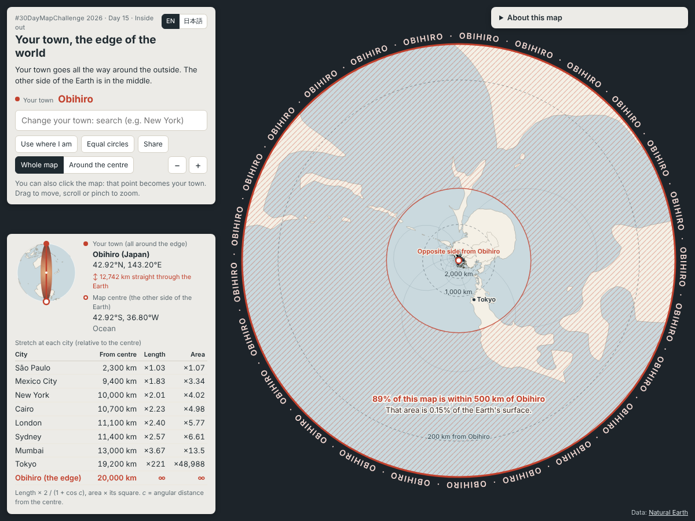

# Your town, the edge of the world

**#30DayMapChallenge 2026 — Day 15: Inside out**
("Inside out, upside down. Something on this map is not quite right.")

**Live:** https://shinyanakashima.github.io/30daymapchallenge-2026day15-edge-of-the-world-/



Pick your town. It goes all the way around the outside of the map, and the other side of the Earth (the antipode) is in the middle. The map uses the stereographic projection centred on the antipode, so your town is stretched to infinite size and becomes the outer edge of the world.

The map opens with Obihiro, Hokkaido (42.92°N, 143.20°E) selected. Its antipode, 42.92°S, 36.80°W, is in the South Atlantic Ocean, east of Argentina. Most of the world sits in a small area in the middle; Hokkaido and the sea around it fill the outer half of the disc.

The page is in English and can be switched to Japanese (日本語).

## How to use

- **Your town** is shown at the top of the panel. Change it by searching a town by its English name. Major cities, and towns in Japan, can also be found by their Japanese name (e.g. 帯広).
- **Click** the map: that point becomes your town. The centre turns smoothly to the new antipode (switched instantly when the device asks for reduced motion).
- After a place is chosen, the map turns with the whole disc in view, zooms in on the area around the centre to show where it is, and then returns to the whole map. **Whole map / Around the centre** switch between the two views.
- The red hatched band is everything within 500 km of your town. It covers 89% of the map, but only 0.15% of the Earth's surface.
- **Drag** to move the centre. **Scroll / pinch** to zoom.
- Country names appear where the map is enlarged enough to fit them.
- **Use where I am** makes your current position (from the browser) your town. A blue marker for it stays on the map when you choose other places, until the page is reloaded.
- **Equal circles** shows circles that all have a 500 km radius on the ground, placed at increasing distance from the centre (the same idea as Tissot's indicatrix).
- **Share** copies a link of the form `?lat=&lon=&name=`. If the place came from your location, you are asked to confirm first.

The small globe in the corner panel shows the Earth from the side, with the selected place at the top and the map centre at the bottom, joined by a red line through the Earth's centre (12,742 km). The globe turns around that line. The map centre is marked with the same white-and-red dot on the main map.

The corner panel also shows the selected place, the map centre (the antipode) and whether it is on land or sea, and how much a set of major cities is enlarged.

## The projection

- Stereographic projection (`d3.geoStereographic`). It is conformal: angles are kept, so small shapes look right, but scale grows with distance from the centre.
- On a Mercator map, scale grows away from the equator. On this map, scale grows away from the centre.
- The centre is the antipode of the selected place: for a place at (lat, lon) the centre is (−lat, lon + 180°), set with `projection.rotate`.
- At angular distance *c* from the centre, lengths are enlarged by 2 / (1 + cos *c*) and areas by the square of that. At *c* = 180° (the selected place itself) the enlargement is infinite, so the place cannot be drawn as a point and appears as the outer circle.
- Dashed circles mark fixed ground distances from the selected place. Because they are centred on the projection centre, they appear as concentric circles.

## Notes

- **Clipping.** The map is cut at 178.5° from the centre (`clipAngle(178.5)`). The area within 1.5° (about 170 km) of the selected place is not drawn; the outer circle stands for it.
- **Location.** Your location is used only inside your browser. It is not sent anywhere and not saved, and it is not written to the address bar. It goes into a link only if you press Share and confirm.
- Country borders use the 1:110m data while the map is moving and the 1:50m data when it stops.

## Data

- [Natural Earth](https://www.naturalearthdata.com/) (public domain)
  - Admin 0 – Countries, 1:110m and 1:50m, as TopoJSON from [world-atlas](https://github.com/topojson/world-atlas) 2.0.2
  - Admin 0 – Countries 1:50m: names and label points (`data/country-labels.json`, built with `scripts/build-country-labels.mjs`)
  - Populated Places, 1:10m (`data/places.json`, built with `scripts/build-places.mjs`)
- Libraries: [D3](https://d3js.org/) 7.9.0, [topojson-client](https://github.com/topojson/topojson-client) 3.1.0 (ISC licence, files in `vendor/`)

## Run locally

No build step. Serve the folder with any static server, for example:

```sh
python3 -m http.server 8000
```

To rebuild the town list and the country names:

```sh
curl -LO https://raw.githubusercontent.com/nvkelso/natural-earth-vector/master/geojson/ne_10m_populated_places.geojson
node scripts/build-places.mjs ne_10m_populated_places.geojson
curl -LO https://raw.githubusercontent.com/nvkelso/natural-earth-vector/master/geojson/ne_50m_admin_0_countries.geojson
node scripts/build-country-labels.mjs ne_50m_admin_0_countries.geojson
```

Deployed to GitHub Pages by `.github/workflows/pages.yml` on every push to `main`.
